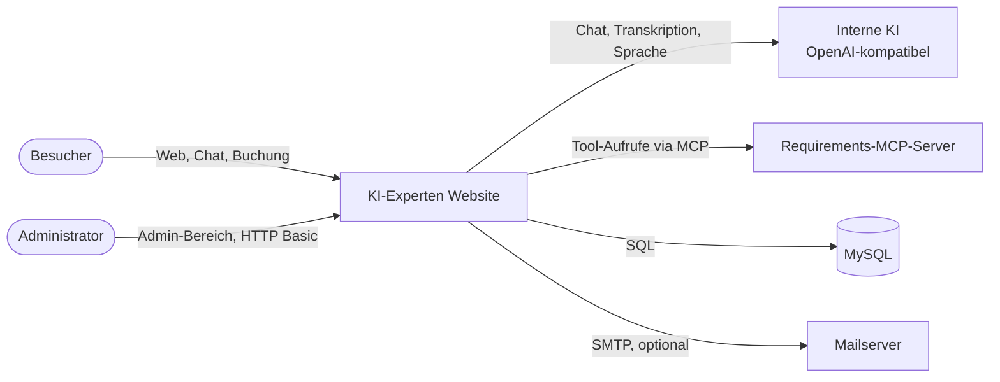
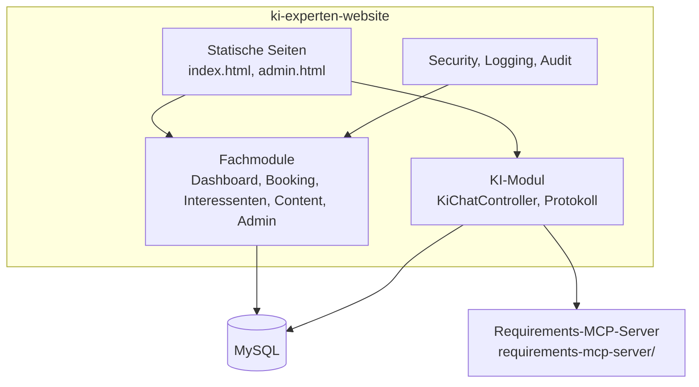
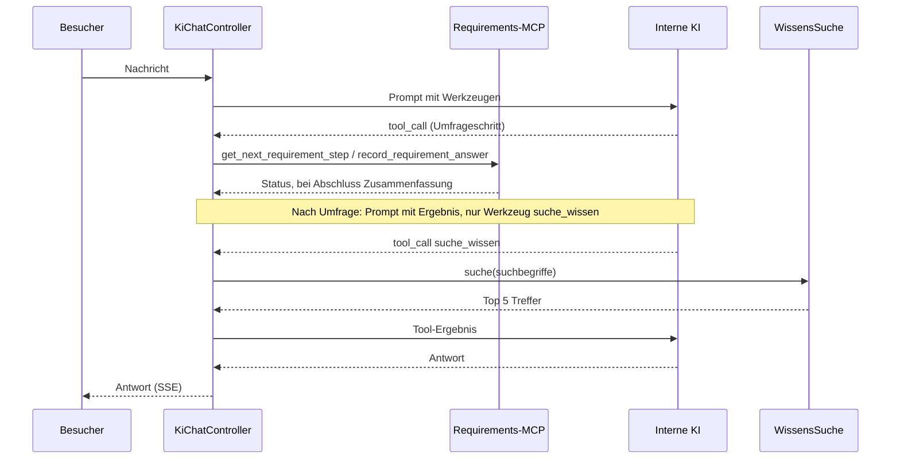

# KI-Experten Website – arc42 Dokumentation

Architekturdokumentation nach dem [arc42](https://arc42.org)-Template.

---

## 1. Einführung und Ziele

### 1.1 Aufgabenstellung

Die Website der KI-Experten stellt Leistungen und Angebote vor, beantwortet Fragen per KI-Chat, nimmt Interessenten und Terminbuchungen entgegen und bietet einen Admin-Bereich zur Pflege der Inhalte.

Wesentliche Funktionen:

- **KI-Chat** mit geführter Bedarfsumfrage, Zusammenfassung und Terminbuchung
- **Wissensquellen** (Dashboard): Texte und Anhänge, die die KI bei Fragen durchsucht (opt-in pro Quelle)
- **Terminbuchung** mit Bestätigungs-E-Mail
- **Interessenten** und **Chat-Protokolle** im Admin-Bereich
- **Zugriffslog**, **Papierkorb** (Soft-Delete) und **Audit** der Änderungen
- **Spracheingabe** (Transkription) und **Sprachausgabe** (Speech) über die interne KI

### 1.2 Qualitätsziele

| Priorität | Qualitätsziel | Bedeutung |
|---|---|---|
| 1 | Datenschutz | Kundendaten bleiben im Unternehmen; KI läuft intern |
| 2 | Sicherheit | Admin-Bereich nur mit Authentifizierung, CSRF-Schutz, verschlüsselte Dashboard-Daten |
| 3 | Nachvollziehbarkeit | Zugriffslog, Audit-Felder und Papierkorb für Änderungen |
| 4 | Erweiterbarkeit | Neue Fachbereiche als eigene Pakete; KI-Werkzeuge über MCP |

### 1.3 Stakeholder

| Rolle | Erwartung |
|---|---|
| Besucher / Interessenten | Verständliche Informationen, einfache Terminbuchung |
| Administratoren | Pflege von Inhalten, Wissensquellen, Interessenten und Protokollen |
| Entwicklungsteam | Wartbarer Code, klare Schichten, lauffähig lokal und im Betrieb |
| Datenschutz / Compliance | Keine Abflüsse von Chatinhalten an externe Dienste |

---

## 2. Randbedingungen

| Bereich | Vorgabe |
|---|---|
| Programmiersprache | Java 21 |
| Framework | Spring Boot 3.5.6, Spring AI 1.1.8 |
| Build | Maven (`pom.xml`, Wrapper `mvnw`) |
| Datenbank | MySQL (utf8mb4); H2 nur für Tests |
| Schema | `spring.jpa.hibernate.ddl-auto=update` (automatische Schemaanpassung) |
| KI | Intern gehostetes, OpenAI-kompatibles Modell |
| Frontend | Statische HTML/CSS/JS-Seiten, ohne Build-Schritt |
| Konfiguration | Umgebungsvariablen mit Defaults in `application.properties` |

---

## 3. Kontextabgrenzung

### 3.1 Fachlicher Kontext



| Nachbar | Richtung | Zweck |
|---|---|---|
| Besucher | ein/aus | Website, Chat, Terminbuchung |
| Administrator | ein | Pflege der Inhalte |
| Interne KI | aus | Antworten, Transkription, Sprachausgabe |
| Requirements-MCP-Server | aus | Umfrageschritte und Antworten erfassen |
| MySQL | bidirektional | Persistenz |
| Mailserver | aus | Bestätigungs-E-Mails (optional) |

### 3.2 Technischer Kontext

| Schnittstelle | Protokoll / Pfad |
|---|---|
| Web | HTTP, Port 8080 (`server.port`) |
| Chat | Server-Sent Events (SSE) |
| KI | HTTP, OpenAI-kompatibel (`/chat/completions`, `/audio/...`) |
| MCP | Streamable HTTP (`APP_REQUIREMENTS_MCP_URL`) |
| Datenbank | JDBC MySQL (`DB_URL`) |

---

## 4. Lösungsstrategie

- **Schichtenmodell in Spring Boot:** Controller, Service, Repository, JPA-Entities. Pro Fachbereich ein Paket.
- **Geführter Chat:** Der Chat folgt einem Umfrageablauf, der über MCP-Werkzeuge gesteuert wird. Nach Abschluss ersetzt der Server den Prompt und bietet nur noch die Wissenssuche an.
- **Wissenssuche:** Stichwortbasierte Suche in Java über freigegebene Wissensquellen. Keine Vektor-Datenbank.
- **Sicherheit:** Spring Security mit HTTP Basic für den Admin-Bereich und CSRF-Schutz (Cookie `XSRF-TOKEN`). Dashboard-Daten werden hybrid verschlüsselt ausgeliefert.
- **Nachvollziehbarkeit:** Auditierbare Entities (`Auditable`), Soft-Delete über den Papierkorb, Zugriffslog per Filter.
- **Konfiguration:** Alle betriebsabhängigen Werte über Umgebungsvariablen.

---

## 5. Bausteinsicht

### 5.1 Ebene 1: Container-Übersicht



### 5.2 Ebene 2: Pakete

| Paket (`src/main/java/de/kiexperten/`) | Verantwortung |
|---|---|
| `KiExpertenApplication` | Einstiegspunkt |
| `ki` | KI-Chat, Umfrage-Gateway (MCP), Chat-Protokoll, Sprüche |
| `dashboard` | Wissensquellen, Todos, Dashboard-API, Wissenssuche (`WissensSuche`) |
| `booking` | Terminbuchung und Bestätigung per E-Mail |
| `interessenten` | Interessenten-Erfassung und -Verwaltung |
| `content` | Inhalte der öffentlichen Website |
| `admin` | Admin-Funktionen (Skript-Ausführung u. a.) |
| `config` | Konfiguration, u. a. `SecurityConfig` |
| `audit` | Auditierbarkeit, Papierkorb, Create-Guard |
| `logging` | Zugriffslog (Filter, Controller, Entity) |

### 5.3 Ebene 2: Frontend

| Datei | Zweck |
|---|---|
| `static/index.html`, `index.js`, `index.css` | Öffentliche Website und Chat |
| `static/admin.html` | Admin-Bereich (Wissensquellen, Interessenten, Protokolle) |
| `static/user-menu.js` | Benutzermenü |

### 5.4 Wichtige Entities

| Entity | Zweck |
|---|---|
| `Wissensquelle` | Titel, Inhalt (HTML), Flag `kiVerfuegbar` für die KI-Suche |
| `Anhang` | Dateianhänge zu Wissensquellen |
| `ChatProtokoll` | Protokollierte Chat-Verläufe |
| `ZugriffsLog` | Zugriffsprotokoll |

---

## 6. Laufzeitsicht

### 6.1 KI-Chat mit Wissenssuche



### 6.2 Terminbuchung

1. Besucher wählt einen freien Slot (`/api/termine`).
2. Buchung wird angelegt; Bestätigungslink per E-Mail (ohne `spring.mail.host` nur im Log).
3. Bestätigung über den Link erstellt einen Termin im Google-Kalender und eine individuelle Google-Meet-Konferenz.
4. Die Buchenden erhalten eine Bestätigungs-E-Mail mit Terminzeit, Dauer, optionaler Nachricht und Meet-Link.

Für den Kalenderzugriff müssen `GOOGLE_CLIENT_ID`, `GOOGLE_CLIENT_SECRET` und `GOOGLE_REFRESH_TOKEN` als
Umgebungsvariablen gesetzt werden. Das autorisierte Google-Konto braucht einen Refresh-Token mit dem OAuth-Scope
`https://www.googleapis.com/auth/calendar.events`; `GOOGLE_CALENDAR_ID` ist optional und verwendet standardmäßig
`primary`. Ohne diese Konfiguration kann ein Termin nicht bestätigt werden; nach einem API- oder Mailfehler kann
derselbe Bestätigungslink erneut aufgerufen werden.

Gesetzliche Feiertage aller Bundesländer einschließlich örtlicher Feiertage sind in Berliner Zeit
ausgeschlossen. Ein Klick auf den Feiertag im Kalender zeigt seinen Namen an; auch die Buchungs-API
lehnt diese Tage ab.

### 6.3 Admin-Bereich

Anmeldung per HTTP Basic (`ADMIN_USER`, `ADMIN_PASSWORD`). Änderungen laufen über die Dashboard-API; Lesezugriffe liefern verschlüsselte Payloads.

---

## 7. Verteilungssicht

| Komponente | Umgebung |
|---|---|
| Spring-Boot-Anwendung (JAR) | Server im Unternehmen, Port 8080 |
| MySQL | Datenbankserver, Datenbank `kiexperten` (utf8mb4) |
| Interne KI | Eigener Server im Unternehmen (Standard `https://100.65.185.69/v1`) |
| Requirements-MCP-Server | Eigener Prozess, Standard `http://127.0.0.1:8091` |
| Mailserver | Optional, per SMTP |

### 7.1 Start

Datenbank anlegen (MySQL):

```sql
CREATE DATABASE kiexperten CHARACTER SET utf8mb4 COLLATE utf8mb4_unicode_ci;
```

Anwendung starten:

```bash
export DB_USER=kiexperten DB_PASSWORD=... ADMIN_PASSWORD=...
./mvnw spring-boot:run
```

Wichtige Variablen:

| Variable | Standard | Bedeutung |
|---|---|---|
| `DB_URL`, `DB_USER`, `DB_PASSWORD` | lokal `kiexperten` | Datenbank |
| `ADMIN_USER`, `ADMIN_PASSWORD` | `admin`, leer | Admin-Zugang (Passwort erforderlich) |
| `APP_REQUIREMENTS_MCP_ENABLED` | `false` | Schaltet Umfrage und Wissenssuche ein |
| `APP_REQUIREMENTS_MCP_URL` | `http://127.0.0.1:8091` | MCP-Server |
| `APP_PUBLIC_URL` | `http://localhost:8080` | Basis-URL für Links in E-Mails |
| `MAIL_FROM` | `no-reply@localhost` | Absender |
| `ADMIN_SCRIPT` | leer | Optionales Skript für den Admin-Button |

---

## 8. Querschnittliche Konzepte

### 8.1 Sicherheit

- Spring Security; Admin-Bereich mit HTTP Basic.
- CSRF-Schutz: Cookie `XSRF-TOKEN`, Header `X-XSRF-TOKEN`.
- Dashboard-Daten werden mit `HybridEncryption` verschlüsselt ausgeliefert.
- HTML-Eingaben werden mit Jsoup bereinigt (Safelist).
- Umfrageergebnisse werden im Prompt als reine Daten gekennzeichnet.

### 8.2 Persistenz

- JPA/Hibernate mit MySQL; `ddl-auto=update` legt neue Spalten automatisch an.
- Soft-Delete über `deleted_at` (`@SQLRestriction`); gelöschte Einträge liegen im Papierkorb.
- `open-in-view` ist deaktiviert.

### 8.3 Protokollierung und Audit

- `Auditable` erfasst Erstellung und Änderung.
- `ZugriffsLogFilter` protokolliert Zugriffe.
- `ChatProtokollService` speichert Chat-Verläufe.

### 8.4 Konfiguration

- Alle betriebsabhängigen Werte über Umgebungsvariablen mit Defaults.
- Optionale Dienste (MCP, Mail) sind abschaltbar.

### 8.5 Tests

- Spring-Boot-Tests mit H2 in-memory (`jdbc:h2:mem:...`).
- Externe Dienste (MCP, Mail) werden per `@MockBean` ersetzt.
- Die KI wird über einen lokalen `HttpServer` simuliert.

---

## 9. Architekturentscheidungen

| # | Entscheidung | Begründung |
|---|---|---|
| ADR-1 | MySQL statt Vektor-Datenbank | Vorhandene Infrastruktur; Stichwortsuche genügt für den aktuellen Umfang |
| ADR-2 | KI intern gehostet | Datenschutz; keine Abflüsse von Kundendaten |
| ADR-3 | MCP für Umfrage-Werkzeuge | Umfrage-Logik liegt getrennt im Requirements-MCP-Server |
| ADR-4 | Wissensquellen opt-in (`kiVerfuegbar`) | Nur freigegebene Inhalte werden öffentlich durchsucht |
| ADR-5 | Suche nur nach Umfrage und nur im MCP-Modus | Vereinfacht den Ablauf; Feature-Flag steuert die Aktivierung |
| ADR-6 | Statische Frontends ohne Build-Schritt | Geringer Betriebsaufwand |

---

## 10. Qualitätsanforderungen

| Qualität | Szenario | Maßnahme |
|---|---|---|
| Datenschutz | Chatdaten verlassen das Unternehmen nicht | Interne KI, Protokoll nur in MySQL |
| Verfügbarkeit | MCP oder Mail fällt aus | Optionale Dienste per Flag abschaltbar, Chat läuft weiter ohne Umfrage |
| Wartbarkeit | Neue Fachfunktion | Eigenes Paket, Repository-Muster |
| Testbarkeit | Ohne Datenbankserver | H2 in den Tests |

---

## 11. Risiken und technische Schulden

| Risiko | Auswirkung | Maßnahme |
|---|---|---|
| Stichwortsuche findet keine Synonyme | Antworten fehlen oder sind unvollständig | Bei Bedarf Vektor-Suche nachrüsten (siehe ADR-1) |
| Anhänge (PDF) werden nicht durchsucht | Wissen aus Dateien bleibt ungenutzt | Textextraktion ergänzen |
| `ddl-auto=update` in Produktion | Keine kontrollierten Migrationen | Auf Flyway/Liquibase umstellen |
| Test `KiChatStreamingTest.servesPublicPageAssetsWithoutAuthentication` | Erwartet `index.css`, HTML verweist auf `/ai/index.css` | Assertion anpassen |
| Admin-Passwort per Umgebungsvariable | Abhängig von sicherer Betriebsumgebung | Secret-Management nutzen |

---

## 12. Glossar

| Begriff | Bedeutung |
|---|---|
| arc42 | Template für Architekturdokumentation |
| KI-Chat | Öffentlicher Chat mit Umfrage und Wissenssuche |
| Umfrage | Geführte Bedarfsanalyse über MCP-Schritte |
| Wissensquelle | Vom Admin gepflegter Textinhalt für die KI |
| `kiVerfuegbar` | Flag, das eine Wissensquelle für die KI-Suche freigibt |
| MCP | Model Context Protocol; Werkzeuge für die KI |
| Soft-Delete | Löschen durch Setzen von `deleted_at`; Wiederherstellung über den Papierkorb |
| Papierkorb | Ansicht gelöschter Einträge |
